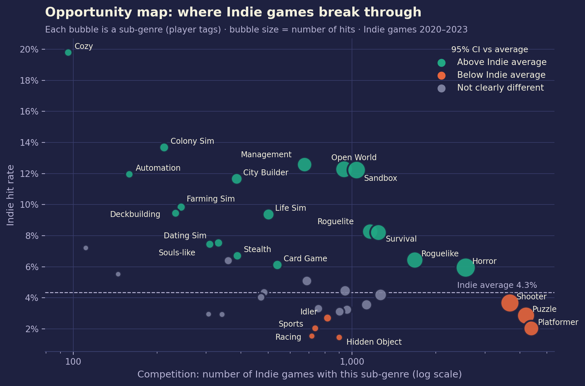

# Press Start: What 36,000 Steam games reveal about Indie success

**Live demo: https://press-start.streamlit.app**

An exploratory data analysis and interactive Streamlit dashboard for one question:

> **If you are a small Indie developer launching on Steam, what can past games tell you about your odds — and where are they better?**

**Author:** Omar Mohammed Al-Faifi · Software Engineer



---

## Dataset

| | |
|---|---|
| **Source** | [Steam Games Dataset — Artemiy Ermilov (Kaggle)](https://www.kaggle.com/datasets/artermiloff/steam-games-dataset) |
| **File used** | `games_march2025_full.csv` (original, unmodified) |
| **Published / collected** | March 2025 snapshot of the Steam store |
| **Size** | 94,948 rows × 47 columns (≈470 MB) |
| **Format / licence** | CSV · licence listed on the Kaggle page (reported as MIT) |
| **Original file MD5** | `a9cb90aa4ab1596eea6839ebcc948cdb` |

The original file is **not stored in this repository** (GitHub's 100 MB limit). Download it from the link above and put it in `data/raw/`.
The cleaned dataset used by the dashboard is included: `data/processed/clean_data.csv`. `python -m src.cleaning` also writes small summary files to `data/processed/pipeline/` (raw column profile, raw and clean sample rows, data-quality evidence, missing values, file sizes) so the dashboard can show the original data without loading the 470 MB raw file.

## Research Questions

1. Are Indie-labelled games less likely to become hits than other games?
2. Which sub-genres give Indie games better odds relative to how crowded they are?
3. Does player satisfaction guarantee visibility?
4. Which product choices are *associated* with Indie hits?
5. Are the conclusions robust to how a "hit" is defined?

## Key Definitions

- **Hit (target):** a game in the **top 5% of Steam review count among games released in the same year**. Comparing within a year is fair to newer games. Review counts measure **visibility, not sales**.
- **Robustness checks:** top 10%, top 5% within the release *quarter*, and the 2024 cohort.
- **Study cohort:** games released **2020–2023** (2024 kept only for robustness).
- **Indie:** the "Indie" genre label chosen by the developer on Steam (not a verified budget or studio size).

## Key Findings (2020–2023, 36,689 games)

| Finding | Number |
|---|---|
| Games with fewer than 10 reviews | **43%** |
| Hit rate — Indie vs non-Indie | **4.2% vs 7.0%** (holds under every hit definition) |
| Indie share of games vs share of hits | **71% vs 59%** |
| Sub-genres clearly above the Indie average (highest first) | Cozy, Colony Sim, Management, Open World, Sandbox, Automation, City Builder… |
| Sub-genres clearly below (lowest first) | Hidden Object, Racing, Platformer, Sports, Idler, Puzzle, Shooter |
| Hidden Gems (≥80% positive, not hits) per *Popular & Loved* game | **≈3.5** |
| Hit Predictor (pre-launch choices only) — test ROC-AUC | **0.84**; top 10% predicted games are hits **25%** of the time vs a 5% base rate |

Higher price, more languages (incl. Arabic), more platforms, multiplayer and achievements are **associated** with Indie hits — associations, not causes.

## Predictive Model (bonus)

`src/model.py` estimates the chance that a game becomes a hit from choices made **before launch**: price band (Free,
under $5, $5–10, $10–20, $20+; one-hot, not a straight line), Indie label, Early Access, multiplayer, number of platforms,
release month, Steam core genres and sub-genres. Price is a confounder — it stands for budget and scope — so it is an
association, not a lever: raising the price of the same game will not make it a hit.
Languages, achievements and DLC are excluded because they are often added after a game succeeds; reviews, playtime,
owners and the visibility/quadrant columns are excluded because they are measured after launch or built from the target.

- **Model:** L2 logistic regression, `class_weight="balanced"`, then sigmoid probability calibration. All preprocessing
  sits inside a scikit-learn `Pipeline` (fitted on training data only).
- **Validation:** stratified 80/20 split (`random_state=42`); `C` tuned with 5-fold stratified CV on the training set;
  the test set is used once at the end; extra time check trained on 2020–2022 and tested on 2023.

| Metric | Value |
|---|---|
| Train ROC-AUC | 0.839 |
| CV ROC-AUC (5-fold, mean ± std) | 0.831 ± 0.009 |
| Test ROC-AUC | 0.838 |
| Time check: 2020–2022 → 2023 ROC-AUC | 0.824 |
| Average precision (test) | 0.279 |
| Hit rate among top 10% predicted (test) | 24.8% (base rate 5.0%) |
| Brier score (test) | 0.0412 |
| Chosen C | 0.03 |

No overfitting: train − test gap = 0.001 (flag threshold 0.03). A shallow random forest reaches almost the
same test ROC-AUC, so the explainable logistic regression is used. Retrain with `python -m src.model`; the dashboard only loads
`models/hit_model.joblib` and `models/metrics.json`. Coefficients are associations, not causes.

## Data Cleaning Summary

| Step | Rows after | Removed | Why |
|---|---:|---:|---|
| Raw file | 94,948 | – | Original Kaggle file |
| Remove test builds | 89,701 | 5,247 | Playtests / betas; some show the main game's reviews |
| Remove software | 88,665 | 1,036 | Only software genres (Utilities, Video Production…) |
| Remove adult content | 85,162 | 3,503 | Adult genre, Sexual Content / Nudity in the top-5 tags, NSFW / Hentai in the top-10 tags, explicit words in the name, or a short manual list |
| Remove duplicate editions | 84,970 | 192 | Several pages sharing one identical review pool |
| Keep releases 2020–2024 | 54,159 | 30,811 | Recent market (2020–2023 study + 2024 check) |

Other key decisions: `num_reviews_total = -1` means **fewer than 10 reviews** (Steam shows no summary below 10), so these games are kept as low-visibility instead of dropped; SteamSpy's `positive`/`negative` columns were not used because they disagree with Steam's own counts and miss many recent games.

## Project Structure

```
press-start/
├── src/                     # all the logic (plain Python, work here in VS Code)
│   ├── config.py            # paths, study settings, colours
│   ├── cleaning.py          # cleaning + feature engineering + hit target
│   ├── analysis.py          # shared calculations (hit rates, CIs, opportunity map…)
│   ├── model.py             # Hit Predictor: training, validation, explanation
│   └── plots.py             # static charts for the notebook / slides
├── notebooks/
│   ├── eda.ipynb               # concise EDA notebook (submission)
│   └── visual_analysis.ipynb   # detailed version (loading, cleaning summary, charts, insights, model)
├── app/
│   ├── app.py               # Streamlit entry point: router, sidebar text, top navigation bar
│   ├── common.py            # shared style, cached data + model, UI helpers
│   ├── charts.py            # interactive Plotly charts
│   ├── views/               # one file per page
│   │   ├── home.py          #   HOME: title screen with the three modes
│   │   ├── story.py         #   STORY MODE: the analysis tabs + sidebar filters
│   │   ├── hit_lab.py       #   HIT LAB: Hit Predictor + model card
│   │   └── arcade.py        #   ARCADE: Indie Run
│   └── game/indie_run.html  # self-contained canvas game (no external files)
├── data/
│   ├── raw/                 # put games_march2025_full.csv here (not in git)
│   └── processed/           # clean_data.csv + cleaning_log.csv
│       └── pipeline/        # small files for the Data Pipeline tab
├── models/                  # hit_model.joblib + metrics.json (python -m src.model)
├── reports/figures/         # exported PNG charts
├── .streamlit/config.toml   # dark theme
├── requirements.txt         # dashboard packages, pinned (used by Streamlit Cloud)
└── requirements-dev.txt     # + Jupyter packages for the notebooks
```

notebooks/eda.ipynb - concise EDA notebook (submission)

## How to Run

```bash
# 1. Clone and enter the project
git clone https://github.com/<your-username>/press-start.git
cd press-start

# 2. Create a virtual environment and install packages
python3 -m venv .venv
source .venv/bin/activate        # Windows: .venv\Scripts\activate
pip install -r requirements.txt       # the dashboard (exact tested versions)
pip install -r requirements-dev.txt   # optional: also Jupyter packages to run the notebooks

# 3. (Optional) rebuild the cleaned data from the original file
#    put games_march2025_full.csv in data/raw/ first
python -m src.cleaning
python -m src.plots
python -m src.model      # retrain the Hit Predictor

# 4. Run the dashboard
streamlit run app/app.py
```

Open `notebooks/visual_analysis.ipynb` in VS Code (Jupyter extension) to see the full analysis with outputs.

**Online (Streamlit Community Cloud):** live at https://press-start.streamlit.app. The dashboard runs from this repo with Python 3.12 and main file `app/app.py`. It only reads files that are in the repo (`data/processed/`, `models/`, `app/game/`, `.streamlit/config.toml`), never the raw Kaggle file.

## Dashboard

**Live demo: https://press-start.streamlit.app** (Streamlit Community Cloud)

The dashboard works like a game main menu with three modes. Run `streamlit run app/app.py` locally, or open the live demo; it opens on **HOME**.

**How to navigate:** the pixel bar at the top of every page has **HOME / STORY MODE / HIT LAB / ARCADE** (the current page is pressed in). On HOME, each mode card has a big button that opens it. Every page has its own address (`/`, `/story`, `/hit_lab`, `/arcade`) and the browser tab shows the page name, e.g. "Press Start | Hit Lab". Filter values and Hit Predictor ideas are kept when you switch pages.

- **Sidebar (all pages):** dataset description and data source. The **filters** (release year slider, studio type dropdown, price slider, genre multiselect, minimum reviews) appear only in STORY MODE; HIT LAB and ARCADE say that the filters do not affect them.
- **HOME:** blinking PRESS START title, three equal-height mode cards (pixel-art icon as an inline SVG on a 16x16 grid, short subtitle, one-line description, big button aligned at the bottom) and three headline numbers: Indie vs non-Indie hit rate, share of games with fewer than 10 reviews, and the model's test ROC-AUC. No Key insights box.
- **STORY MODE** (the analysis, as tabs; each tab ends with its own *Key insights* box, numbers follow the filters):
  - **Overview:** KPIs, releases per year, price and rating distributions, summary statistics
  - **Data Pipeline:** original vs clean file (rows, columns, size), cleaning funnel, raw vs clean rows for the same games, data-quality findings with evidence, feature-engineering table with the hit definition, and missing values before vs after
  - **Indie Reality:** hit-rate gap with 95% confidence intervals under four definitions
  - **Opportunity Map:** competition vs hit rate per sub-genre or genre
  - **Loved vs Seen:** popularity vs satisfaction quadrants + top Hidden Gems
  - **Hit Patterns:** historical comparison of similar Indie games (sample size, confidence interval, *Insufficient data* warning, matching hits) and "What do Indie hits have in common?"
  - **Game Explorer:** search, sort and download the data
- **HIT LAB:** the *Hit Predictor* as a mini-game on its own page. Build an idea from pre-launch choices (incl. price band) and get a **rank** S/A/B/C/D against every 2020–2023 Indie game (S = top 5%, A = top 20%, B = top 40%, C = top 70%), "better than X% of Indie games", the calibrated hit chance, the factors that moved the score, up to 3 **power-ups** (one-step changes that raise the chance by 0.5+ points; price is never suggested because it stands for budget), **Roll the dice** (a random realistic idea from a real Indie game's profile), and similar real hits. You work on one idea at a time. A **Model card** shows test ROC-AUC, CV ROC-AUC, the train/test gap, the features used, and the features excluded and why. Ends with a Key insights box.
- **ARCADE:** *INDIE RUN*, a playable pixel endless runner (HTML5 canvas, vanilla JavaScript, all art drawn in code), shown large (16:9, up to 1000 px wide, always fully inside its card). You play a small Indie developer. Jump over BUGs and ZERO REVIEWS gaps, slide under CRUNCH bars, and collect review stars (+10). Power-ups: MULTIPLAYER (shield), LOCALIZATION (star magnet), COZY (slow motion). Each level is a release year (2020 → 2024, then ENDLESS), and speed and obstacle density follow the real number of Indie releases that year. Power-ups show the real hit rate of the factor they are named after, and the game-over screen shows a real fact. Python passes only a small JSON of numbers from the clean data. Click the game to focus it; keys only reach the game while it has focus. Controls: Space / Up / W = jump (twice = double jump), Down / S = slide, P = pause; touch: tap = jump, swipe down = slide. Best score is kept in the browser. Below the game: "How the game uses the data" and a Key insights box.

## Limitations

- Reviews measure visibility, not sales or profit; estimated owners are wide SteamSpy ranges and are not used as sales.
- Single snapshot: prices, languages and achievements are March 2025 values, not launch values.
- "Indie" is a self-declared label.
- Player tags are missing for ~20% of games (mostly unseen ones).
- The adult-content filter uses the top-5 player tags, so it also removes some mainstream games with nudity tags (e.g. Cyberpunk 2077, Atomic Heart, Wasteland 3). This does not change the main conclusions. A few adult games may remain.
- Observational data: correlations, not causes.

## References

- Ermilov, A. *Steam Games Dataset* (March 2025). Kaggle. https://www.kaggle.com/datasets/artermiloff/steam-games-dataset
- Steam Web API & SteamSpy (original data sources of the dataset).
